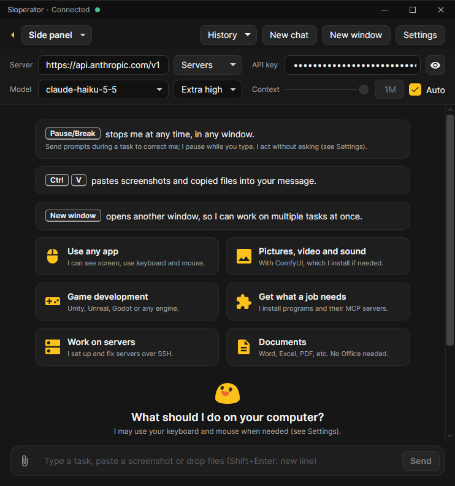

# Sloperator
Sloperator works on your PC to get the job done. Say what you want and watch it go.\
It uses the actual desktop via keyboard and mouse when needed.

It is a single portable `Sloperator.exe`. Nothing gets installed.\
Its settings, chats and whatever it downloads stay in a `SloperatorData` folder next to the exe.



## Getting started
1. Download `Sloperator.exe` from [Releases](https://github.com/forcepusher/Sloperator/releases) and
   put it in whatever folder you like (not Program Files).
2. Double-click it. If Windows says "Windows protected your PC", click **More info**, then
   **Run anyway**.
3. Type what you want and press Enter.

**Pause/Break** stops it at any time, and **Shift+Pause/Break** skips a wait. It doesn't ask before it acts; to change that see Settings.
While it works, a yellow frame goes round the screen. It waits for you to leave the mouse and keyboard
alone before it acts, and locks them for the moment it clicks or types; Pause/Break gives them back,
and the Stop button always takes a click.
Turn on **Notify me when done** there to get a Windows notification when a task needs you.
Sloperator updates itself: when a new version is ready, a line under the top bar says so, with
**Restart**.

## Connecting a model
- **Free, no account:** out of the box it runs on Kilo's free online models. They allow about 200
  requests an hour.
- **Claude:** type `api.anthropic.com` as the server and your Anthropic API key next to it.
- **Your own PC:** in [LM Studio](https://lmstudio.ai), turn its server on in the Developer tab and type
  `http://localhost:1234/v1` as the server. Pick a model that sees images (Qwen3.8 27B is the one
  tested most), give it at least 64k of context, and turn off its "Image Input: Never exceed 2048 px"
  option. llama.cpp, Ollama and vLLM work the same way.
- **Other online APIs:** any OpenAI-compatible server, such as [OpenRouter](https://openrouter.ai): its address and your key.

On **Auto**, the first row of the model and effort lists and where both start, a cheap model looks at each message first
and picks the model and effort for it from three you set in Settings (the newest Claude Haiku, Sonnet
and Opus unless you change them). Before a dearer model it asks, and takes it after 10 seconds. Or
pick a model and effort yourself. Every server that answered is under **Servers**, with its key and
model, to switch back to.

If you still have no idea what to do, you can ask the free model to connect another model for you.\
Same with MCPs, tell Sloperator what you want to be connected and it'll be done.

## Building (you don't have to, download from [Releases](https://github.com/forcepusher/Sloperator/releases))
You need Windows and the .NET 10 SDK.

```powershell
dotnet build             # debug build, keeps its SloperatorData in .dev/
dotnet test              # unit tests
./scripts/publish.ps1    # makes publish/Sloperator.exe
```

Details are in [docs/notes.md](docs/notes.md), which is meant to be read by LLMs, not people.

Making a release: [docs/releasing.md](docs/releasing.md).

## Code signing policy
Free code signing provided by [SignPath.io](https://about.signpath.io), certificate by
[SignPath Foundation](https://signpath.org).

- Committers and reviewers: [forcepusher](https://github.com/forcepusher)
- Approvers: [forcepusher](https://github.com/forcepusher)

Every release is built from this repository by GitHub Actions and signed only after an approver
accepts it.

Privacy: Sloperator sends your messages, files and screenshots only to the model server you pick
(out of the box, Kilo's free online models), and reaches other servers only when you or a task
ask for it. It also checks GitHub for a new version once an hour, unless you turn that off in
Settings. To remove it, delete `Sloperator.exe` and its `SloperatorData` folder.
